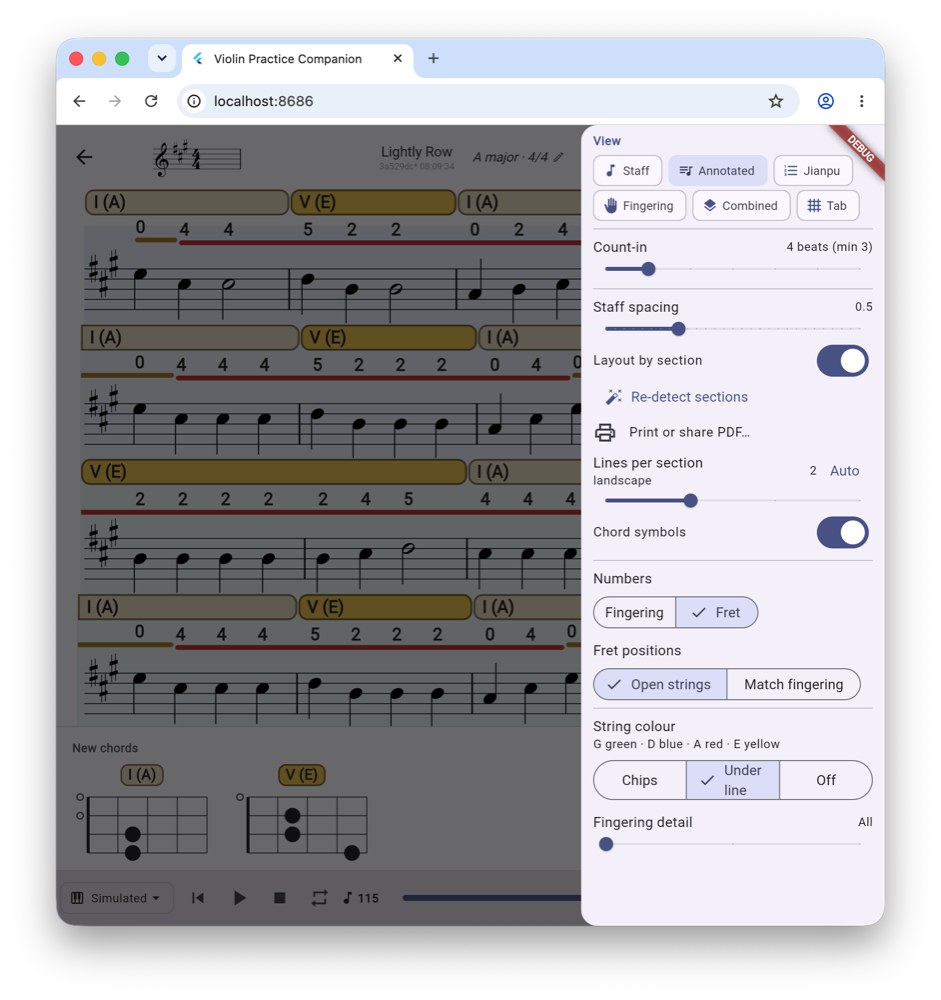

# Stringlings

A free, open-source practice companion for children learning violin — built for
the non-music-reading parent trying to help a frustrated six-year-old.

Useful for families following any structured violin method, including Suzuki,
Colourstrings, and others that use a fixed beginner repertoire.

## The Problem

Many violin methods are built around listening and imitation, with a teacher at
the centre. But between lessons, a parent who cannot read Western staff notation
is largely helpless. They cannot tell their child which notes to play, cannot
identify where the child has gone wrong, and cannot follow along with the score
while the child practises.

At the same time, many families learning violin come from musical traditions
where **jianpu** (簡譜, numbered musical notation) is the common written
language for music. A B is not a B — it is "A1", first finger on the A string.

This app bridges that gap.

## What It Does

**Scan a page from your violin method book** and the app converts it into the
notation that works for your family:

- **Staff notation** — a clean re-rendering of what was scanned, useful for
  verifying the scan was correct
- **Jianpu** — numbered notation (1–7) with octave dots and rhythm underlines,
  familiar to many East Asian musical traditions
- **Fingering notation** — shows each note as its string and finger: `A1`, `D2`,
  `E0` (open string), etc., directly useful for a beginner child

**Practise smarter:**

- Select any measure or range of measures for targeted practice
- Pieces can be annotated with their section structure (ABAA etc.) so you can
  work on just one part at a time
- MIDI playback at adjustable tempo, with a bouncing ball or measure highlight
  following along
- Import a short video of your teacher playing the piece; the app aligns it to
  the score so tapping any measure jumps the video to the right moment. If the
  recording has talking or tuning before the tune, you can say where the music
  starts and ends and it will be matched against just that

<p align="center">
  
</p>

*Lightly Row in the web build, Annotated view, laid out by section with chord
symbols, fret numbers and string-colour underlines. To run it yourself, see
[Running in a browser](#running-in-a-browser).*

## What It Does Not Do

- Connect to the internet — ever
- Require a subscription or account
- Contain any sheet music — you supply your own legally purchased book
- Make editorial choices about fingerings — it computes first-position
  fingerings from music theory, independently of any published edition

## Philosophy

No company at the centre. No server costs. No lock-in. The app is a piece of
code you can build yourself, inspect, modify, and share freely.

The scanning approach is deliberate: rather than distributing copyrighted
musical arrangements, the app processes a copy you already own. The underlying
melodies in most beginner repertoire are public domain; what is copyrighted is
the publisher's specific editorial choices (fingerings, bowings, articulation).
The app reads your copy to recover the notes and rhythms, then generates its
own notation independently.

*This project is not affiliated with or endorsed by the International Suzuki
Association or any other method organisation.*

## Building

```bash
flutter pub get
bash scripts/gen_build_info.sh   # writes lib/build_info.dart (gitignored); needed before the first build or test
flutter run                  # development
flutter build apk            # Android
flutter build ios --no-codesign  # iOS
flutter build macos          # macOS
flutter build web            # Web / PWA
```

iOS requires an Apple developer account for device installation; on a free
(personal) account the installed build stops launching after 7 days and has to be
reinstalled. The web build works on iPhone Safari as a PWA with no account
required. To put a build on a real phone or iPad, use `scripts/device_install.sh`
— see [Installing on a physical
device](#installing-on-a-physical-device) below. For the day-to-day simulator
loop, see [From a cold Mac to the app on the iPad
simulator](#from-a-cold-mac-to-the-app-on-the-ipad-simulator) below.

The scan-to-MusicXML (OMR) feature needs homr's ONNX models, fetched once with
`bash scripts/fetch_omr_models.sh` — see [OMR (Scan-to-MusicXML)](#omr-scan-to-musicxml)
below. It is not available on the web build.

### Running in a browser

The quickest way to try the app — no Xcode, simulator or device needed, just
Flutter and Chrome:

```bash
flutter pub get
flutter run -d chrome --web-port 8686    # opens Chrome at http://localhost:8686
```

`--web-port` is optional, but a fixed port keeps the browser's saved pieces
between runs: the web build stores its library in the browser, keyed by origin,
so a new random port starts with an empty library. To serve a release build to
another browser on your network instead:

```bash
flutter build web
python3 -m http.server 8686 --directory build/web
```

To load the [dev library](#dev-library-the-same-pieces-and-media-on-every-dev-device)'s
pieces, run `bash scripts/push_dev_library_web.sh` (before launching, or then
reload the tab). It packs scores, titles, sections and collections into
`web/dev_library.json` (gitignored), which the app merges at launch. This is one-way:
edits made in the browser are kept there but never pulled back. Media are left out,
and `flutter build web` ships the file if it's there
(`--remove` deletes it).

What differs from iOS: scanning (OMR) is not available, so add pieces with
**Import from ABC** on the piece list. Everything needed to render notation in the browser
(the Verovio worker and WASM toolkit, pdf.js) is already vendored in `web/`;
there is no extra setup step.

## Simulator names

The docs and scripts refer to these simulators by name rather than by UDID:

| Name            | Device                   | Role                          |
| --------------- | ------------------------ | ----------------------------- |
| `dev-iphone-se` | iPhone SE (3rd gen)      | primary compact (phone) target |
| `dev-iphone`    | iPhone 17                | larger phone                  |
| `dev-ipad`      | iPad Pro 11-inch (M5)    | tablet                        |
| `shots-iphone`  | iPhone 17 Pro Max        | App Store screenshots, 6.9"   |
| `shots-ipad`    | iPad Pro 13-inch (M5)    | App Store screenshots, 13"    |

`dev-iphone-se` matches the physical phone this is built for, and at 375×667pt
it is the smallest screen the compact layout has to fit — 375pt tall in
landscape, and no home indicator, so a zero bottom safe inset. Check phone
layout work there first; `dev-iphone` shows how it scales up.

These are ordinary simulators that have been *renamed*. Both `simctl` and
`flutter -d` accept a device name wherever they accept a UDID, so the name is
all you ever need to type:

```bash
xcrun simctl boot dev-ipad
xcrun simctl io dev-ipad screenshot shot.png
flutter run -d dev-ipad
```

UDIDs are per-machine, so on a new Mac set the names up once — pick whatever
iPhone/iPad you actually have and rename them:

```bash
xcrun simctl list devices available          # find the UDIDs
xcrun simctl rename <iphone-udid> dev-iphone
xcrun simctl rename <ipad-udid>   dev-ipad
xcrun simctl create dev-iphone-se "iPhone SE (3rd generation)"
```

The rename is stored with the device, so it survives reboots and shows up in
Xcode too. Nothing else needs to change. A first `flutter run` on a newly created
simulator is a cold Xcode build (about two and a half minutes), and the dev
library is synced onto it by `bash scripts/dev_run.sh <name>` (every launch does
that; `--no-sync` skips it). If you have no suitable device,
create one (`xcrun simctl create dev-ipad "iPad Pro 11-inch (M5)"`); if the iOS
runtime is missing entirely, install it with `xcodebuild -downloadPlatform iOS`.

Renaming hides the hardware model, so to check what a `dev-*` name actually is:

```bash
xcrun simctl list devices -j | grep -B2 dev-ipad     # deviceTypeIdentifier
```

`flutter -d` matches an exact name or a **name prefix**, not a substring — so
`-d dev-ip` is ambiguous across the two, and `-d ipad` matches neither.

## From a cold Mac to the app on the iPad simulator

The full sequence after a reboot. Nothing here survives a restart, so it's all
of it, in order.

**1. Point the command-line tools at Xcode.** Only needed once per machine, but
it's the failure that looks like everything else being broken:

```bash
xcode-select -p          # should print .../Xcode.app/Contents/Developer
# if it prints /Library/Developer/CommandLineTools:
sudo xcode-select -s /Applications/Xcode.app/Contents/Developer
sudo xcodebuild -license accept
```

**2. Boot the iPad.** A reboot shuts every simulator down, and `flutter devices`
only lists *booted* ones — so this comes before anything Flutter-side:

```bash
xcrun simctl boot dev-ipad
open -a Simulator          # bring the simulator window up
```

Wait for it to reach `Booted` (the first boot after a restart is the slow one):

```bash
xcrun simctl list devices | grep dev-ipad   # want "(Booted)"
```

No `dev-ipad` on this machine? See [Simulator names](#simulator-names) above.

**3. Confirm Flutter sees it:**

```bash
flutter devices          # dev-ipad should now be in the list
```

**4. Fetch packages and stamp the build:**

```bash
flutter pub get
bash scripts/gen_build_info.sh    # writes lib/build_info.dart
```

`build_info.dart` is gitignored, so it won't exist on a fresh clone and the
build fails without it. It puts the git hash + timestamp in the AppBar on debug
builds, which is how you tell which build is actually live.

**5. Launch the dev server** on the iPad. The helper script does the fifo dance
from `CLAUDE.md` (kill any existing run, boot the device, open the control
pipe):

```bash
bash scripts/dev_run.sh dev-ipad     # omit the argument for dev-iphone
```

Or by hand, if you want the run in your own shell:

```bash
rm -f /tmp/flutter_ctl && mkfifo /tmp/flutter_ctl
flutter run -d dev-ipad < /tmp/flutter_ctl 2>&1 | tee flutter_run.log &
exec 3>/tmp/flutter_ctl     # hold the pipe open so the fifo doesn't close
```

`exec 3>` holds the pipe open only for the life of *that* shell, so this form needs
an interactive one you keep around. The script uses a detached holder instead, which
is why it works when invoked from a script or a tool call that returns.

**6. Watch it come up.** The first build after a reboot is a cold one — a couple
of minutes is normal:

```bash
tail -f flutter_run.log
```

You're up when the log prints `Flutter run key commands` and a `VM Service`
URL.

**7. Drive it from there.** Treat `flutter run` as a dev server for the rest of
the session rather than restarting it:

```bash
echo "r" > /tmp/flutter_ctl    # hot reload — keeps widget state
echo "R" > /tmp/flutter_ctl    # hot restart — resets state
```

If a change doesn't show up, check the *build* before the code: re-run `bash
scripts/gen_build_info.sh` before the reload and confirm the new stamp appears in
the AppBar. `Reloaded 0 libraries` in `flutter_run.log` means the change was never
compiled — a long-lived run can stop noticing edits, and only a relaunch
(`scripts/dev_run.sh dev-ipad`) clears it.

A full relaunch (steps 4–5 again) is needed for changes to `main()`,
`pubspec.yaml`, or **anything under `assets/`** — assets are baked into the
`.app` at `flutter run` time, so a hot restart will keep serving the old one.

To screenshot the running iPad, including the notation WebView, see
[Screenshots & UI debugging](#screenshots--ui-debugging-ios-simulator) below —
`xcrun simctl io dev-ipad screenshot shot.png`.

## Installing on a physical device

```bash
scripts/device_install.sh                 # defaults to the phone, JamzJamzJamzz ("Jamz" for short)
scripts/device_install.sh JamzJamzJamzz   # or a device name / UDID
```

Signing is already configured in `ios/Runner.xcodeproj` (team `V8MB2893V6`,
automatic), so this needs no Xcode round trip.

### Why the device asks you to trust the developer *every* time

Two separate mechanisms, and the usual suspect — certificate rotation — is not
one of them. The signing certificate here is stable for a year
(`security find-identity -v -p codesigning` shows one identity, valid May 2026 →
May 2027).

**The re-trust is caused by the uninstall.** iOS keys the "Developer App" trust
record to the signing *certificate*, and drops that record the moment the last
app signed by it leaves the device. `flutter install` and `flutter run -d <phone>`
both print `Uninstalling old version...` before every install — so each one takes
the trust with it, and the next launch is blocked with:

> Unable to launch … because it has an invalid code signature, inadequate
> entitlements or its profile has not been explicitly trusted by the user

`scripts/device_install.sh` avoids this by installing with `devicectl`, which
goes over the top without uninstalling:

```bash
xcrun devicectl device install app --device <udid> build/ios/iphoneos/Runner.app
```

Trust once, and it should then persist across installs. When you do need it:
**Settings → General → VPN & Device Management → Developer App → Trust**.

**Builds expire with their provisioning profile.** Check one with:

```bash
security cms -D -i build/ios/iphoneos/Runner.app/embedded.mobileprovision \
  | plutil -p - | grep -E "TimeToLive|ExpirationDate"
```

`TimeToLive = 7` is a free (personal) team's profile: the app stops launching a
week after it was minted. The team has been on the paid Developer Program since
November 2026, which gives 365 — the App Store profile shows `364`. But Xcode
keeps using a cached development profile until it expires, so the first device
builds after the upgrade still carried a 7-day one. To get a year-long one
straight away, delete the stale profile and build again; Xcode mints a new one:

```bash
ls ~/Library/Developer/Xcode/UserData/Provisioning\ Profiles/
# delete the "iOS Team Provisioning Profile: name.howison.violinPracticeCompanion"
# file whose TimeToLive is 7 (not the "Team Store" one), then:
scripts/device_install.sh
```

### `flutter install` does not rebuild

Worth knowing on its own: `flutter install` reuses whatever is already in
`build/ios/iphoneos/Runner.app` and does **not** build first. It will exit 0
having put a binary from hours ago on the phone. Always build explicitly, and
check the artifact's timestamp rather than trusting the exit code — which is what
`scripts/device_install.sh` does:

```bash
stat -f '%Sm' build/ios/iphoneos/Runner.app/Frameworks/App.framework/App
```

Note also that a **release** build does not show the `kBuildRef` stamp in the
AppBar — that is debug-only — so on a device, confirm the build by the feature you
came to test rather than by reading the stamp.

### A new device: "This provisioning profile cannot be installed on this device"

The free-team profile lists the device UDIDs it covers, and a device Xcode has
never built for is not among them. `flutter build ios` doesn't register devices,
so have Xcode do it once, targeting the new device by UDID
(`xcrun devicectl device info details --device "<name>" | grep udid`):

```bash
cd ios && xcodebuild -workspace Runner.xcworkspace -scheme Runner \
  -configuration Release -destination 'id=<UDID>' \
  -allowProvisioningUpdates -allowProvisioningDeviceRegistration build
```

then run `scripts/device_install.sh "<name>"` as usual. Check what a profile
covers with
`security cms -D -i build/ios/iphoneos/Runner.app/embedded.mobileprovision | plutil -extract ProvisionedDevices json -o - -`.

### Xcode and `devicectl` hang: the device is stuck at "connecting"

`xcrun devicectl list devices` shows the phone as `connecting` rather than
`available`, Xcode spins, and every `devicectl` command hangs. That isn't caused
by anything this project does. Diagnosed 2026-10-19 from the CoreDevice log: the
phone's USB connection dropped, CoreDevice failed to clean it up (`Can't handle
disconnect with invalid ecid`), and Xcode's reconnect request then never
completed. The tunnel stayed up but dead (`packets in/out=4/0`, flat), and every
later request, Xcode's or `devicectl`'s, queued behind the stuck one.

Unplug the phone, restart the two daemons (they relaunch themselves), replug,
unlock:

```bash
pkill -9 remotepairingd CoreDeviceService
xcrun devicectl list devices      # want: available
```

Both run as your own user, so no `sudo` (which also can't prompt for a password
from Claude Code's `!` prefix or an agent's shell). The same restart cleared a
phone stuck at `unavailable` over Wi-Fi while awake and unlocked (2026-11-17):
`devicectl` failed every install with `unable to locate a device matching the
requested device identifier`, even though `device_install.sh`'s reachability
check had passed.

If it still says `connecting`, reboot the phone. A flaky cable or hub, or a
phone that keeps resetting USB when it locks, will bring it back. The scripts
pass `--timeout` to every `devicectl` call, so they fail with an error instead
of hanging along with Xcode. To see it yourself, capture the log while it's
stuck (it needs sudo):

```bash
sudo log show --last 30m --predicate 'process == "remotepairingd" OR process == "CoreDeviceService"'
```

## TestFlight and the dev loop

TestFlight adds a route; it doesn't replace the others.

| Route | For | When |
|---|---|---|
| Simulator, debug (`scripts/dev_run.sh`) | everyday work: hot reload, Marionette | constantly |
| Phone, release (`scripts/device_install.sh`) | real audio, camera, performance; the smoke test | when a change touches the device, and before every upload |
| TestFlight | what testers (and you, as a user) run | when there's something worth handing out |

**You can't install the App Store `.ipa` yourself.** `flutter build ipa` signs it
for App Store distribution, which only TestFlight or the App Store can install.
`device_install.sh` builds the same commit signed for development; that is the
local equivalent, and the smoke test before an upload.

**A dev build and the TestFlight build are the same app on the device.** They
share the bundle id, so installing one replaces the other, keeping the data. A
dev install on Jamz takes the TestFlight copy away until you reinstall it from
TestFlight. (A separate `.dev` bundle id would let them sit side by side, at the
cost of updating every script that names the bundle id; worth it once there are
outside testers.)

**What a tester sees is not your library.** A fresh install has only the bundled
pieces (`assets/library/catalog.json`). The dev library reaches a device only as
`Documents/dev_library/`, staged over the cable by `sync_dev_library.sh`, so a
TestFlight install never merges it. But a TestFlight build installed *over* a dev
build is an update and keeps everything already there. To see the tester's first
launch: sync the device, delete the app, install from TestFlight — or use a device
that has never had a dev build. Deleting the last app signed by the development
certificate drops the developer trust, so the next `device_install.sh` will need
a re-trust (see above).

**Each upload:**

1. Bump the build number in `pubspec.yaml` (`1.0.0+3` → `+4`). Every upload
   needs a new one; the version (`1.0.0`) changes only when the user-facing
   feature set does.
2. `flutter test` (and `VPC_PUBLIC_RELEASE=1 flutter test` before any
   *external* testers — it refuses the `internal-testing-only` play-along tracks).
3. Smoke-test on the phone: `scripts/device_install.sh --release-smoke` (without
   it, Jamz and Hazel iPad get the tuner's recording compiled in), then play a piece (the
   synth), calibrate once (the claves), a scan.
4. `flutter build ipa --release`, then upload with the API key from 1Password
   (Touch ID prompts; the key goes in as an argument, never to disk — altool
   can't read `--p8-file-path` from a pipe):
   ```bash
   I="op://Private/App Store Connect API"; KID=$(op read "$I/key_id")
   xcrun altool --upload-app --type ios -f build/ios/ipa/Stringlings.ipa \
     --apiKey "$KID" --apiIssuer "$(op read "$I/issuer_id")" \
     --auth-string "$(op read "$I/AuthKey_$KID.p8" | grep -v -- ----- | tr -d '\n')"
   ```
   (Or drag the `.ipa` into Transporter.) Processing takes 10–30 minutes;
   encryption compliance is already answered in `Info.plist`.
   Once the build shows as processed, `uv run scripts/push_listing.py --apply`
   writes its What to Test, adds it to the "First round testers" group and
   submits it for Beta App Review; testers are notified when it's approved.
5. Tag the commit it was built from with the full version: `git tag -a v1.0.0+4`,
   and push the tag.

Internal testers (people on the App Store Connect team) need no review; external
testers need Beta App Review and the test information (description, feedback
email). TestFlight builds expire after 90 days. Upload when there's something to
test, not on a schedule.

## Sharing a piece (AirDrop and friends)

In a piece's drawer, **Share piece and recordings…** packs the score, its
sections and the recordings you tick (each demo's video optional) into one
`<title>.stringlings` file and opens the system share sheet: AirDrop, Messages,
Mail, Files, Quick Share. Opening that file on a device with the app imports
it and opens the piece.

- Format and merge rules: `lib/services/piece_share_bundle.dart` (a zip:
  `bundle.json`, `score.musicxml`, `sections.json`, `media/<mediaId>/…`).
  Alignments travel, so a shared recording plays highlighted without realigning.
- The receiver keeps the sender's piece id, so a second share of the same piece
  adds only the recordings it lacks. Different music under that id asks
  Replace / Keep both. A catalog piece the receiver's build lacks arrives under
  a fresh id.
- Receiving is `IncomingSharePlugin` (`ios/Runner/*.swift`, registered as a
  scene delegate; `android/.../*.kt`, VIEW/SEND intents) → `lib/services/incoming_share.dart`
  → `lib/widgets/incoming_share_handler.dart`. iOS declares the type
  `name.howison.violinPracticeCompanion.piece` in `Info.plist`.
- **iOS needs `LSSupportsOpeningDocumentsInPlace` = YES.** Since iOS 17 an
  AirDropped file lands in Files ▸ Downloads, and Files opens it in an app
  only if that app opens documents in place. With NO, the file arrives and
  nothing will open it. So the plugin gets the user's own file behind a
  security scope; it copies it to `Library/Caches/` and never deletes the
  original.
- **Testing without AirDrop** (simulators can't): `xcrun simctl openurl
  dev-iphone-se "file:///abs/path/x.stringlings"` runs the real import path. To
  get a file the app made, tap Share… and copy it out of the app's
  `Library/Caches/share_out_*/`. The log prints one `[share] …` line per
  export and import.

## Imported video is shrunk to 720p

An imported (or shared-in) video is re-encoded on the device to 720p HEVC at
2 Mbps (H.264 where there's no HEVC encoder): 159 MB → 27 MB, 41 MB → 12 MB
on real files. That's still sharp at full screen on an iPad and far more than
the docked strip or floating window needs. The **audio track is copied, not
re-encoded**, so playback sounds the same and cached alignments stay valid.
Measured: decoded audio identical to the original, offset by at most 0.8 ms.

- Native: `shrinkVideo` on the decoder channel (`ios/Runner/AudioDecoderPlugin.swift`,
  AVAssetReader/Writer; `android/.../VideoShrinker.kt`, Media3 Transformer).
  Skips a video that is already ≤720p and ≤3 Mbps, or whose audio can't go
  into an mp4 unchanged.
- Dart: `lib/services/video_shrinker_io.dart`. The shrink runs in the
  background after import (and at launch for older media). The new
  `video_720.mp4` takes over **at the next launch**, and the original is
  deleted the launch after that. Swapping mid-session would reload whatever
  is playing. The log prints `[video_shrink] …` lines.

## What the app cleans up after itself

The file picker, photo picker, image cropper and document scanner each leave a
scratch copy of whatever they hand over, and never delete it. On one iPad that
was ~330 MB (a 159 MB picked video, scan pages in three directories).
`lib/services/storage_cleanup_io.dart` deletes each copy as soon as it has been
read. Thirty seconds after launch it also sweeps anything over a day old: old
scratch files, and media files no stored preference names (it does nothing if
there are no media rows at all). Kept scan pages
(`scan_sources/`) are re-encoded as JPEG at quality 92 after each scan, and
older PNGs are converted at launch. Log lines: `[cleanup] …`,
`[scan_sources] …`.

## Dev library (the same pieces and media on every dev device)

A fresh install starts empty. Rather than re-adding tunes and media by hand, every
dev device can share one library, kept in a private sibling repo,
`../violin_dev_library`, and synced **over the cable** — the app has no network
dependency, and a release build contains none of it:

```bash
bash scripts/sync_dev_library.sh dev-iphone      # simulator
bash scripts/sync_dev_library.sh "Hazel iPad"    # physical device
bash scripts/device_install.sh "Hazel iPad"   # install, then sync (always; --no-sync skips)
bash scripts/dev_run.sh dev-ipad              # sync, then start the dev server (same)
```

A sync takes the device's changes into the library (new pieces, edited scores,
sections, imported media, recorded demos, collections), commits them in the
library repo, and stages the library back onto the device, which merges it when
the app next launches. A merge with no conflicts then deletes the staged copy
(`Documents/dev_library/`), so a dev device doesn't hold the library twice.
Sync each device in turn and each sees the other's work.
Pushing the library repo to GitHub is a separate, manual step.

What syncs: everything a user makes, with the same ids on every device — the
`scanned_pieces/`, `editable_fixtures/`, `section_overrides/`, `media/` and
`teacher_recordings/`, `scan_sources/` and `abc_sources/` folders of the app's Documents, plus the prefs-held titles,
media rows and library (collections, hidden pieces, renames) in `state.json`.
Cached recording alignments travel too (`alignments` in `state.json`): each
device otherwise keeps whatever alignment its build first computed, forever.

To realign every recording with the current build, run it once on a simulator
and let the sync carry the result: connect Marionette, call the debug extension
`realignAll` (optional `pieceId`), wait for `[realign] done` in
`flutter_run.log`, then `sync_dev_library.sh` that simulator and each device.
The first time a device's own alignment meets a different one in the library,
the library's wins.

How it decides: a three-way merge per item, against what that device held at its
last sync. Whichever side changed since then wins; deletions propagate too. If
the same item changed on both sides, the device's version wins and the sync says
`CONFLICT` — the library's version is the previous commit in its git log.

Two cautions. A device's **first** sync contributes everything already on it, so
a simulator holding its own copies of tunes (under different ids) will add
duplicates; delete them in-app and sync again. And the merge only sees what the
app has written to disk — the sync stops the app first for exactly that reason,
so don't sync while you're mid-edit on the device.

## Screenshots & UI debugging (iOS Simulator)

The staff is rendered by OSMD inside a `WKWebView` (a Flutter "platform view").
Tools that screenshot via Flutter's `RepaintBoundary.toImage()` — including the
Marionette MCP used for agent-driven UI inspection — capture platform views as
**blank white** (a Flutter engine limitation; see `CLAUDE.md`). So they can
verify the surrounding Flutter chrome but **not** the notation itself.

To capture what's actually on screen, including the WebView, screenshot the
simulator's framebuffer directly:

```bash
xcrun simctl io booted screenshot screenshot.png        # the running sim
# or target one by name, if several are booted:
xcrun simctl io dev-ipad screenshot screenshot.png
```

The raw image is in the device's native (portrait) orientation, so if the app
is running in landscape the PNG comes out rotated 90°. Correct it with the
built-in macOS tool:

```bash
sips -r 90 screenshot.png
```

For a quick manual capture you can also use Simulator.app → **File ▸ Save
Screen** (⌘S), which writes a PNG to the Desktop.

This is the only reliable way to verify staff/notation rendering — beaming,
accidentals, the playback cursor — that the WebView draws.

Catching something that only lasts a moment (the count-in, the cursor on a fast
note) needs the capture running *before* you trigger it — a single screenshot
lands seconds too late. See `CLAUDE.md` ("Capturing short-lived UI") for the
armed-burst pattern and for widening the window instead.

## App Store screenshots

App Store Connect wants a 6.9" iPhone set (1320×2868) and a 13" iPad set
(2064×2752). They're captured on two sims kept just for this, `shots-iphone`
and `shots-ipad` (see "Simulator names"). The shot list and captions are in
`docs/app-store-listing.md`, "Screenshots".

```bash
bash scripts/dev_run.sh shots-iphone --dart-define=SCREENSHOTS=true
xcrun simctl status_bar shots-iphone override --time 9:41 --dataNetwork wifi \
  --wifiBars 3 --cellularBars 4 --batteryState charged --batteryLevel 100
```

- `SCREENSHOTS=true` (`lib/debug/screenshot_mode.dart`) hides the build stamp,
  the taller debug toolbar and the DEBUG banner. The app stays a debug build,
  so Marionette still drives it.
- The other build flag there, `TUNER_RECORDING=true`, compiles in the tuner's
  developer session recording (a long press on the tuner's title). Leave it off
  for App Store and TestFlight builds. `device_install.sh` adds it by default
  for JamzJamzJamzz and Hazel iPad; `--release-smoke` leaves it out.
- `dev_run.sh` never syncs the dev library onto a `shots-*` sim. Its piece
  list holds only the bundled public-domain pieces, and nothing relabelled
  there leaks back into the library.
- The teacher recording goes in with
  `bash scripts/sim_add_media.sh --kind recorded shots-iphone lightly_row <file> "Teacher demo"`.
  The audio never leaves the sim, and a screenshot carries none.
- The scan photo is a printed page of a bundled piece, photographed for real,
  loaded with `xcrun simctl addmedia shots-iphone photo.heic`. The photo
  picker and the cropper are native, so a person taps through them.
- The status-bar override is lost when the sim reboots.
- `simctl io screenshot` can't overwrite an existing file there: it fails
  with a permission error and leaves the old one in place. Capture to a new
  path (`/tmp/…`) and `cp` it over.
- Raw captures go in `build/screenshots/raw/{iphone,ipad}/NN.png` (gitignored),
  then `uv run scripts/frame_screenshots.py` adds the captions and writes
  `build/screenshots/out/`. No images are committed.
- `uv run scripts/push_screenshots.py` compares those with the version's
  6.9" iPhone and 13" iPad slots; `--apply` replaces each slot with the local
  set, in file order (same 1Password key as `push_listing.py`).
- The app icon isn't uploaded with these. App Store Connect takes it from the
  build (`AppIcon` 1024×1024 in `ios/Runner/Assets.xcassets`), so it shows
  once a build is attached to the version.

## Distribution

- **Android**: F-Droid (pending submission) or direct APK
- **Web**: self-host the `build/web` output; works as an installable PWA
- **iOS**: TestFlight (internal testing; App Store to follow), or build from
  source with your own developer account. With a free account a build expires
  after 7 days — see [Installing on a physical device](#installing-on-a-physical-device)

## Contributing

Contributions welcome. The most useful contributions right now:

- Section (ABAA) annotations for beginner pieces
- Verified first-position fingering lookup table corrections
- Language translations (the UI targets English and Simplified Chinese)
- Testing the OMR pipeline against real book photos (report the results, not
  the photos)

**Before adding any music, image, recording or document, read
[CONTRIBUTING.md](CONTRIBUTING.md), "Content and copyright".** The repo is
public and GPL, and the editions beginners learn from are not. Two tests
enforce the line on every `flutter test`.

See `docs/explore.md` for the development history and decisions made so far,
and `docs/plan.md` for the remaining roadmap.

### Repository layout

| Path | What | Ships in the app? |
|---|---|---|
| `lib/` | the app | yes |
| `assets/engine/` | converters, OSMD, lookup tables, soundfont and OMR models (fetched) | yes |
| `assets/library/` | bundled pieces, listed with source and licence in `catalog.json` | yes |
| `test/`, `integration_test/` | tests and public test fixtures | no |
| `dev/` | dev-only entrypoints (e.g. `flutter run -t dev/verovio_harness.dart`) | no |
| `scripts/` | dev tooling: device install, dev-library sync, content cleanup, OMR evaluation | no |
| `docs/` | design notes, plans, our own ABC sources | no |
| `packages/` | vendored dependencies (`jovial_svg`) | yes, as code |

**The soundfont** is not committed. Download GeneralUser GS (S. Christian
Collins, schristiancollins.com) and cut it down to the two sounds the app plays,
the violin and the calibration claves (31 MB → 0.9 MB):

```bash
python3 scripts/subset_soundfont.py path/to/GeneralUser-GS.sf2 \
    assets/engine/soundfonts/generaluser_gs.sf2 --keep 0:40 --keep 128:0:75
```

If the app starts playing another instrument, add its `--keep` and rerun.

Material that can't be public lives in a private companion checkout
(`../violin_practice_restricted`); tests that use it skip without it. See
CONTRIBUTING.md, "Restricted test material".

## OMR (Scan-to-MusicXML)

The "scan a page" feature is powered by [`homr`](https://github.com/liebharc/homr),
ported to an on-device Flutter package, `homr_flutter`
([github.com/jameshowison/homr_flutter](https://github.com/jameshowison/homr_flutter),
AGPL-3.0), which this app pins to a release tag:

```yaml
homr_flutter:
  git:
    url: https://github.com/jameshowison/homr_flutter.git
    path: packages/homr_flutter
    ref: v0.2.0
```

A fresh clone needs nothing next to it: `flutter pub get` fetches the tag.
**Models** come separately. They're homr's FP16 ONNX weights (~150 MB, AGPL via
`liebharc/homr`), which the app bundles from `assets/engine/omr_models/` (gitignored).
Run this once per checkout:

```bash
bash scripts/fetch_omr_models.sh   # copies from ../homr_flutter if present, else downloads; checksum-verified
```

`device_install.sh` refuses to build, and `dev_run.sh` warns, while they're
missing; without them scanning would fail at the first recognition.

**Working on both repos at once.** Create a `pubspec_overrides.yaml`
(gitignored) so the app builds against the sibling checkout instead of the
tag:

```yaml
dependency_overrides:
  homr_flutter:
    path: ../homr_flutter/packages/homr_flutter
  xml: ^7.0.1   # repeats pubspec.yaml's override; this file replaces that section
```

Rename it to `pubspec_overrides.yaml.off` (also gitignored) and re-run
`flutter pub get` to build exactly what's pinned. That's the normal state,
and the one release builds need. **To upgrade**: in homr_flutter, bump
the package `version` and `CHANGELOG.md`, commit, tag `vX.Y.Z` and push the tag;
here, change `ref:` and run `flutter pub upgrade homr_flutter`. `pubspec.lock`
records the commit the tag resolved to.

Pipeline (`lib/services/omr_service*.dart`): document scan
(`flutter_doc_scanner`) → crop to the music region in colour, at full
resolution (`image_cropper`) → resize to 1920 px wide + CLAHE, as Python homr
does (inside `OmrOrchestrator`) → on-device ONNX inference (segmentation +
transformer recognition) → assembled MusicXML, parsed by `MusicXmlParser` into
a `ParsedPiece`.

Every scanned piece keeps the images it was recognised from in
`Documents/scan_sources/<pieceId>/`: `page_<n>_original.*` as acquired, and
`page_<n>_crop.*`, the colour crop the recogniser actually received. When a
scan comes out wrong, look there first; the dev-library sync brings them back
to the Mac (`../violin_dev_library/scan_sources/`). Pieces scanned before this
existed have none.

**Mobile/desktop only.** `flutter_onnxruntime` and `flutter_doc_scanner` don't
support web, so `omr_service.dart` conditional-imports a stub on web
(`omr_service_web.dart`) that throws `UnsupportedError`. A server-side `homr`
(Python) backend for a future web/laptop-camera path is planned but not built.

**Platform requirements** (set by `flutter_onnxruntime`):
- iOS deployment target 16.0+
- macOS deployment target 14.0+

OMR accuracy on Suzuki Book 1 (homr_flutter, 2026-06-09): **17/18 perfect**
(SER=0%). Full findings in `homr_flutter/docs/omr_evaluation/`.

### Time signatures: the model reads only the bottom digit

homr's transformer has no token for a time signature's top digit, only
`timeSignature/<denominator>`. Its training-data converters read MusicXML
`<beat-type>` and kern `*M3/4`'s denominator and never `<beats>`
(upstream `training/omr_datasets/music_xml_parser.py:624`, the kern and Lieder
converters likewise). That was a deliberate choice. Commit `712d207`
(2024-06-24) dropped the full `timeSignature-4/4`-style tokens to shrink the
vocabulary: "we can easily infer the numerator from the number of notes in a
measure. The transformer doesn't seem to make a lot of use from the time
signature information." Upstream `Vocabulary.md` says the beats are
"reconstructed from the median measure length". The author calls it "a
shortcut" in liebharc/homr#167. Common time (C) is read as 4/4.

What follows from that, and what we do about it:

- **The top digit is computed, never read.** Since homr_flutter 0.3.0, each
  time signature the model sees starts a stretch, and its top digit is that
  stretch's median bar length. Upstream takes one median over the whole piece,
  which made a 3/4 + 4/4 medley "7/4". A time signature over nothing but rests
  has no bars to measure, so it gets common time for its denominator (4/4,
  2/2, 6/8), since 0.3.2.
- **The app checks the result against the bars.** `MeterRepair`
  (`lib/services/meter_repair.dart`) fixes digits that don't fit the bars under
  them and removes restatements.
- **What it can't do:** a meter that has no rhythm to measure (rests only)
  can be wrong, and an unmarked one-bar change (a lone 2/4) is left flagged
  for the measure editor.

To actually read the digits, two routes exist, neither built:

1. **Retrain with a numerator token.** The OurTextScores fork of homr adds
   `timeSignatureBeats_<n>` before the existing `/d` token, so old checkpoints
   still load (`release/v11-minimal`, `homr/transformer/vocabulary.py:17`). Its
   weights are private, so this means fine-tuning homr's checkpoint ourselves.
2. **OCR the digits.** homr's segmentation has no time-signature class (the
   digits fall into background), but the transformer's per-token attention
   gives a rough position for the `timeSignature/d` token. Our port discards it
   (`transformer_runner.dart`). Kept, it would locate a crop for the app's
   text recogniser, the one that reads titles.

## Thanks to MusicXML

The whole app runs on [MusicXML](https://www.w3.org/2021/06/musicxml40/),
created by Michael Good at Recordare and now developed in the open by the W3C
Music Notation Community Group. Our thanks to them. One format carries a tune
from scanner (homr), ABC importer and measure editor to engraver (Verovio),
playback and sharing, and none of these parts has to know about the others.

First and second endings show how well the format works. A volta is not a
special kind of measure. It is a mark on the barline,
`<ending number="1" type="start"/>` on the first bar under the bracket and
`type="stop"` (closed hook) or `"discontinue"` (open end) on the last, and it
sits next to the `<repeat>` that sends the player back. So:

- homr's `voltaStart`/`voltaStop` tokens became `<ending>` elements, with no
  agreement needed between the projects beyond the format;
- the ABC importer turns abcjs's `startEnding`/`endEnding` bar flags into the
  same elements, and the exporter writes them back as `[1` and `[2`;
- the measure editor's "ending" toggle writes the same elements, rebuilding
  the brackets over the part;
- Verovio draws the brackets from the markup, with no app code;
- `ParsedPiece.performanceOrder` reads `number="1, 2"` as "play this bar on
  passes 1 and 2", and MIDI playback, the minimap and the recording aligner
  all follow from that.

Adding endings meant teaching each part to read or write one documented
element. None of them needed changes to the others.

## Licence

GPL-3.0-or-later (see `LICENSE`). You may use, modify, and redistribute this
code freely. You may not wrap it in a proprietary or subscription product. The
OMR package it uses, `homr_flutter`, is AGPL-3.0, as is homr; GPLv3 section 13
permits the combination, with that part keeping its own terms.

## Profile run (logged to a file)

To install and run on the `dev-iphone` simulator in **profile** mode while
capturing all output to a file an agent can read back, run this from the repo
root:

```bash
flutter run --profile -d dev-iphone 2>&1 | tee flutter_profile.log
```

- `--profile` builds the release-grade engine with profiling enabled (no debug
  asserts, no hot reload, and the debug-only Marionette binding is disabled).
- `2>&1 | tee flutter_profile.log` mirrors stdout **and** stderr to the terminal
  and to `flutter_profile.log`, so the agent can `tail`/`grep` that file (e.g.
  `tail -n 50 flutter_profile.log`) without watching the live session.

Swap in another device name from `flutter devices` (e.g. `-d dev-ipad`, or
`-d macos`) as needed. The plain debug dev-server pattern (hot reload via a
fifo) lives in `CLAUDE.md`.
